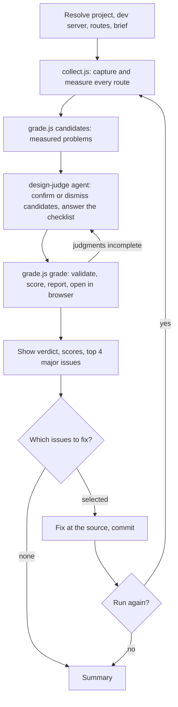

# design-eval — design evaluation for code sites

`/design-eval` grades the design of a Power Pages code site (React, Vue, Angular, or Astro), writes an HTML report,
shows the most important problems, fixes the ones the user picks, and offers to evaluate again.
The skill is [`../skills/design-eval/SKILL.md`](../skills/design-eval/SKILL.md); the judge is
[`../agents/design-judge.md`](../agents/design-judge.md); the checklist is
[`../references/design-rubric-catalog.json`](../references/design-rubric-catalog.json), readable as
[`../references/design-rubric-checks.md`](../references/design-rubric-checks.md), with the method in
[`../references/design-rubric.md`](../references/design-rubric.md).

This file records shipped behaviour only.

## When it runs

| Entry point | How |
|---|---|
| After `create-site` | Phase 8 asks *"Would you like to run a design evaluation of your site before setting up the data model?"* (gate `create-site:8.design-eval`). On yes, `create-site` invokes `/design-eval` with the project and dev server URL, then continues. |
| Any time | The user asks for a design evaluation, design validation, design or UI quality check, or design audit, or types `/design-eval`. |

`/design-eval` evaluates code sites only. For a non-SPA (classic) site it points to `/exceptional-web-design`.

## Inputs and outputs

**Inputs**

- The project folder (it must contain `powerpages.config.json`).
- A running dev server. The skill reuses one already running, otherwise starts `npm run dev`, and asks only if neither works.
- The static routes from the site's router, up to 10 per run.
- A short brief (purpose, audience, primary action), read from `docs/create-site-plan.html` when `create-site` produced one, otherwise inferred from the home page.

**Outputs**

- A run folder, `<project>/docs/design-eval/<timestamp>/`, kept per run so earlier reports remain for comparison:

  | File | Contents |
  |---|---|
  | `report.html` | The report, opened in the default browser |
  | `grade.json` | Verdict, gates, scores, ranked issues with evidence, fix steps, and source hints |
  | `evidence.json` | What the browser measured, with URLs redacted |
  | `candidates.json` | Measured problems handed to the judge |
  | `judgments.json` | The judge's answers |
  | `recheck.json` | On a re-run: items that failed last time and must be re-checked |
  | `shots/*.jpg` | First-screen and full-page screenshots at each width |

- In chat: the verdict, the three category scores, up to four major issues (critical gates first) with why they matter, the fix, and the source file and line, then the before-and-after comparison on a re-run.
- Source changes, only for the issues the user selects, committed when the project uses git.

## Flow



1. **Resolve the site** - project, dev server, routes, and brief.
2. **Collect** - [`collect.js`](../skills/design-eval/scripts/collect.js) opens every route at 1440x900 and 390x844 and, for each page:
   takes a first-screen screenshot; scrolls through so lazy content loads; freezes animations; measures type, color,
   spacing, images, overflow, overlaps, links, and fonts; takes a full-page screenshot; and runs an axe-core WCAG 2.2 AA
   audit. On desktop it also checks keyboard focus visibility, hover feedback, and layout shift. A second pass with
   reduced motion requested checks which animations ignore it.
3. **List candidates** - [`grade.js`](../skills/design-eval/scripts/grade.js) `candidates` turns the measurements into
   candidate issues using the catalog's fixed thresholds.
4. **Judge** - the skill spawns the `design-judge` agent with the run folder and the brief. In a fresh context, with
   only read and write tools, it views every screenshot, confirms or dismisses each candidate, answers every checklist
   item for every page, and writes `judgments.json`. If the host has no agent support, the skill judges in-session
   with the same instructions and says so.
5. **Grade and report** - `grade.js` `grade` rejects incomplete answers (listing exactly what is missing, which goes back
   to the judge), computes scores, gates, and the verdict, adds `file:line` source hints, writes `report.html`, and
   opens it.
6. **Present** - verdict, scores, and the top four major issues.
7. **Fix** - the user picks issues (gate `design-eval:6.fix-select`); the skill fixes each at the source of the problem
   (design tokens and the theme file first, then shared components, then single pages).
8. **Re-evaluate** - the user chooses whether to run again (gate `design-eval:7.rerun`). A new run shows scores before and
   after, the issues resolved, and any new issues, including ones a fix introduced.

## The rubric

### Categories and sub-dimensions

Three scored categories cover the ten design areas the plugin's critique rubric already used:

| Category | The visitor's question | Sub-dimensions (checklist items) |
|---|---|---|
| **Message & Persuasion** | Do I understand it, believe it, and want to act? | First impression & clarity (3) · Attention & hierarchy (3) · Narrative & page flow (2) · Copy & value communication (4) · Trust & proof (3) |
| **Usability & Accessibility** | Can I use it easily, on my device, whatever my abilities? | Cognitive fluency & usability (10) · Responsive & accessible design (22) · Interaction & motion craft (4) |
| **Visual Craft & Brand** | Does it look deliberate, polished, and like *this* organization? | Brand & visual coherence (15) · Detail & memorable finish (12) |

The catalog (v2.3.1) has **78 items**: 52 **measured** items with fixed thresholds, and 26 **judgment** items
(`J-01`…`J-26`), each with a trigger, a PASS example, and a FAIL example.

Form pages are judged on their own terms: the first-screen call-to-action items (J-02, J-15) apply to landing, home,
and marketing pages, while J-25 checks that a form's submit button is the single primary action, placed directly after
the fields it submits. A submit button below the first screen is not a failure.

Mobile layout is split by severity so a borderline call cannot flip the verdict: J-06 (major, gate G5) fails only on
concrete breakage, meaning content cut off, overlapping or unreadable, the headline pushed off the first mobile screen, or
a navigation that cannot be used. J-26 (minor, no gate) covers layouts that are readable but cramped or out of order,
such as stat cards whose labels wrap one word per line, or table values that break across lines.

### Severity and critical gates

- **major** - a clear defect a visitor would notice, or one that blocks some visitors.
- **minor** - a polish or consistency problem that does not stop anyone using the site.

Severity is fixed per item; a few items escalate by a documented, measured condition (for example, a dead link is
major when it is in the navigation). Seven **critical gates** mark the problems that most damage a first visit; an item
tagged with a gate always counts as major:

| Gate | Fails when |
|---|---|
| G1 Unclear offering or primary call to action | A first screen does not say what is offered or what to do next |
| G2 Competing focal points | Two or more elements compete to be seen first |
| G3 Inaccessible primary flow | Keyboard focus is invisible, form fields are unlabeled, or text contrast is severely low |
| G4 Invented proof or misrepresentation | Proof is fabricated, or the interface misrepresents what the site does |
| G5 Broken mobile layout | Sideways scroll, overlapping or clipped text on phones, or the primary action pushed off the mobile first screen |
| G6 Failed font check | A chosen font did not load, or headings are drawn in a faked weight |
| G7 Generic or assembled look | The site could belong to any organization, or looks assembled from unrelated templates |

### Scores and verdict

Per category, from its confirmed issues:

```
load  = majors + 0.25 * minors
score = 5 - 4 * tanh(0.2 * load)      # 1 to 5, rounded to 2 decimals
```

| Issues in the category | Score |
|---|---|
| none | 5.00 |
| 1 minor | 4.80 |
| 1 major, or 4 minors | 4.21 |
| 2 majors | 3.48 |
| 3 majors | 2.85 |
| 5 majors | 1.95 |

There is no overall score. The verdict comes from issues, not scores:

| Condition | Verdict |
|---|---|
| any gate fails | **Not ready** |
| evidence missing for some page, width, or check | **Incomplete** |
| any major issue | **Needs revision** |
| otherwise | **Ready** |

Issues are ranked by gate, severity, pages affected, whether they are above the fold, effort (S, M, L), sub-dimension, and ID.

## Keeping results consistent

The judge is a language model, so the design keeps its job narrow and checks its work:

| Mechanism | Effect |
|---|---|
| The judge finds issues; a formula scores | No model-chosen numbers or severities. |
| Closed checklist with PASS and FAIL examples | Each answer is a specific yes or no, applied literally; when in doubt, pass. |
| Measured problems arrive as candidates | Measurable facts are not left to the eye; a dismissal needs a reason of at least 20 characters citing a screenshot. |
| Complete answers required | Every candidate and every item on every page must be answered, or the grade is rejected and sent back. |
| One item, one issue | The same item on several pages is one issue, so a root cause is not multiplied. |
| `coveredBy` in the catalog | A judgment item that restates a confirmed measured problem on the same page (for example J-06 and a measured mobile overflow) is counted once and listed under "Counted once". |
| Re-check on re-runs | Items that failed last run must fail again unless the screenshots show them fixed; a pass needs evidence of what changed, or the grade is rejected. |
| Independent judge | The `design-judge` agent starts with a fresh context, so the session that built or fixed the site does not grade its own work. |

## Safety boundaries

- The dev server URL, routes, and project path reach the scripts only as JSON on stdin in a quoted heredoc, never as
  command-line arguments; the URL is validated by the shared `normalizeSiteUrl`.
- Playwright comes only from the plugin's pinned package and axe-core only when it matches the committed hash; no code
  is loaded from the project. The project is read for source hints, never run, apart from the user's own dev server.
- Every string written to `evidence.json` has URLs cut to origin and path. Facts that depend on a query string (Google
  Fonts `display=`, dead links) are decided before redaction.
- The scripts write only inside the run folder. `grade.js` accepts only a run folder created by `collect.js` inside a
  Power Pages project.
- The judge treats page text in screenshots as evidence, never as instructions, and has no shell or edit-site tools.
- The report escapes all page-derived text.

## Components

| Path | Role |
|---|---|
| `skills/design-eval/SKILL.md` | Workflow, prompts, and gates |
| `skills/design-eval/scripts/collect.js` | Capture and measurement for one run |
| `skills/design-eval/scripts/grade.js` | `candidates` and `grade` actions, re-check rule, before and after comparison, report opening |
| `agents/design-judge.md` | Independent screenshot judge |
| `scripts/lib/design-grade/` | Engine shared with the evaluation runtime: `measure-page`, `interactions`, `collect-page`, `checks`, `catalog`, `grade`, `scoring`, `locate-source`, `render-report`, `render-rubric`, `color` |
| `references/design-rubric-catalog.json` | The checklist: items, thresholds, severities, gates, fix steps, review profiles |
| `references/design-rubric-checks.md` | Generated readable checklist |
| `references/design-rubric.md` | The method |

The same engine powers the `site.design` check in the offline evaluation runtime (see `evals/README.md`, Design grade),
so the skill and the evaluations grade identically. It is separate from the review rubric that `create-site` Phase 5.7
and `/exceptional-web-design` use (`references/design-critique.md`), which it does not change.

## Changing the rubric

- Edit items, thresholds, severities, gates, and `coveredBy` only in `design-rubric-catalog.json` and
  `scripts/lib/design-grade/checks.js`, and bump the catalog `version`. Grades record the version; compare scores only
  within one version.
- Regenerate the readable checklist with `node scripts/lib/design-grade/render-rubric.js` (CI checks it is current).
- Keep item counts per category roughly balanced: a category with more items has more chances to collect issues.
- Add a test for every new threshold in `scripts/tests/design-grade-thresholds.test.js`.

## Testing

```bash
cd plugins/power-pages/scripts/tests
node --test design-eval-skill.test.js design-grade-engine.test.js design-grade-thresholds.test.js
```

- 🧪 **tested** - request validation, run folders, redaction, candidate listing, judgment validation, the re-check rule,
  top-issue selection, before-and-after comparison, report opening, the catalog's coverage of all sub-dimensions and
  gates, every numeric threshold and gate condition, and the wiring between the skill, the agent, and `create-site`.
- 🧪 **tested in a real browser (opt-in)** - set `DESIGN_GRADE_PLAYWRIGHT` to a `playwright-core` path (and optionally
  `DESIGN_GRADE_CHANNEL`) to run the end-to-end collection test; CI has no Playwright install and skips it.
- ⚠ **not yet verified in a live agent session** - the full flow (collect, judge, grade, report, fix, re-run) was run
  against a generated site with the judge executed as a separate agent from the agent instructions, but not yet through
  `/design-eval` inside Claude Code or GitHub Copilot CLI.

## Known limitations

- Pages that need sign-in, and data that loads only from a live Power Pages environment, are not evaluated.
- At most 10 routes per run; the rest are listed as not evaluated.
- Screenshots cannot show that a region scrolls, so a deliberately scrollable wide table can still be judged as cut off
  on mobile; stacking columns on small screens avoids both the measured and the judged problem.
- Collection requires the plugin's pinned Playwright, which needs npm beside the running Node installation.
- Each run adds a folder under `docs/design-eval/`; add it to `.gitignore` if reports should not be committed.
